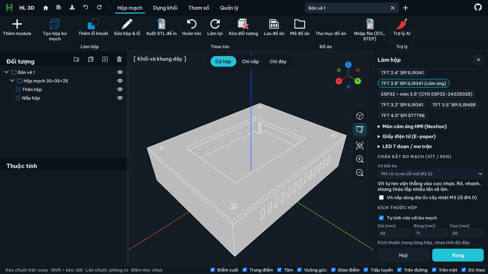

# HL 3D — phần mềm vẽ 3D tiếng Việt, có tab làm hộp cho bo mạch

Phần mềm **vẽ 3D (CAD) đầy đủ, miễn phí, giao diện tiếng Việt**, chạy ngay trên máy. Vẽ được chi tiết cơ khí,
đồ gá, vỏ máy, đồ in 3D... và có thêm **tab Hộp mạch dành riêng cho anh em làm điện tử**: chọn ESP32, Arduino,
relay, nguồn, màn hình là phần mềm tự dựng hộp, tự khoét cổng, xuất STL đem in.

Dựa trên [Chili3D](https://github.com/xiangechen/chili3d) (mã nguồn mở AGPL-3.0) của tác giả xiangechen.



## Có gì trong bản này

### Vẽ 3D đầy đủ (tiếng Việt toàn bộ)

- **Khối cơ bản**: hộp, trụ, nón, cầu, chóp, xuyến...
- **Bản phác 2D**: đường thẳng, cung, tròn, elip, chữ nhật, đa giác, đường cong Bézier; ràng buộc kích thước.
- **Dựng khối**: đùn, xoay tròn, quét theo đường, nối biên dạng (loft), tạo vỏ mỏng, offset.
- **Gộp / khoét / giao khối** (boolean), bo tròn cạnh, vát cạnh, cắt, tách, khâu mặt.
- **Biến đổi**: dời, xoay, đối xứng, nhân bản theo hàng, theo vòng tròn.
- **Mô hình tham số** (tab Tham số): sửa số đo ở bước trước, cả chuỗi dựng tự cập nhật.
- **Bắt điểm** chính xác: điểm cuối, trung điểm, tâm, vuông góc, tiếp tuyến...; mặt phẳng làm việc động.
- **Đo** chiều dài, góc, diện tích, thể tích.
- **Nhập / xuất** STEP, IGES, BREP, STL; Hoàn tác / Làm lại không giới hạn.

### Tab Hộp mạch cho anh em điện tử

- Bấm **Thêm module** → chọn module trong thư viện, hộp tự xếp bo và tự nới kích thước.
  - Thư viện module: ESP32 / ESP32-S3 / C3 / CAM, ESP8266, Arduino Uno / Mega / Nano, Pico, mạng LAN W5500 /
    ENC28J60, RS232, RS485, LoRa, SIM800L, thẻ nhớ, nguồn hạ áp, HLK 220V, pin 18650, relay 1–8 kênh,
    L298N, MOSFET, HX711, DS3231...
  - **Tự khoét cổng** USB, RJ45, DB9, SMA ở thành hộp; chừa sẵn vùng anten WiFi cho ESP32 / ESP8266.
  - **Thư viện màn hình gắn dưới nắp** (hơn 35 loại): OLED 0.91" – 2.42", LCD 1602 / 2004 / 12864 / Nokia 5110,
    TFT 0.96" – 4.0" (cả màn tròn GC9A01 và ESP32 CYD 2.8"), Nextion 2.4" – 7", giấy điện tử 1.54" – 4.2",
    LED 7 đoạn TM1637 / MAX7219, LED ma trận. Nắp tự khoét ô màn và có cọc bắt vít (hoặc gờ chặn góc
    cho màn không có lỗ).
  - Đầu đọc thẻ RC522, PN532 gắn dưới nắp.
  - **Chân bắt bo có ren**: vít tự ren M2 / M2.5 / M3, **đai ốc đồng cấy nhiệt** (heat-set insert),
    **đai ốc lục giác giấu dưới đáy**, **trụ đồng**; chốt kẹp góc cho bo không có lỗ. Vít nắp cũng chọn
    được đai ốc cấy nhiệt.
  - Thêm lỗ nút nhấn, LED, jack nguồn, USB-C, công tắc, lỗ tròn; **kéo lỗ bằng chuột** hoặc nút mũi tên.
  - Xem **Cả hộp / Chỉ nắp / Chỉ đáy**; **Xuất STL để in** ra sẵn thân hộp và nắp (nắp đã lật úp).

### Khác

- **Lưu / mở đồ án** vào thư mục trên máy (khi chạy bằng `server.py` kèm theo).
- **Trợ lý AI** biết làm hộp: gõ "làm cho anh cái hộp gồm ESP32, module relay 2 kênh, màn OLED, thêm 1 LED ở
  mặt trước" là AI tự tạo. AI dùng **API key của chính bạn** (Anthropic, OpenAI hoặc dịch vụ tương thích
  OpenAI), nhập trong khung Trợ lý AI > Cài đặt. Phần mềm không kèm key nào.
- Chuột kiểu quen thuộc: giữ chuột trái / phải kéo để xoay, Shift + kéo để dời, lăn để phóng to.

> Kích thước module và màn hình là **số tham khảo** theo loại phổ biến trên thị trường. Hãy đo bo thật bằng
> thước kẹp và sửa lại trước khi in bản chính.

## Tải về và dùng (Windows)

1. Cài [Python 3](https://www.python.org/downloads/) (khi cài nhớ tick **Add python.exe to PATH**).
2. Vào mục [**Releases**](https://github.com/lduyhoan-design/HL-3D/releases/latest) của trang này, tải file `HL3D-windows.zip`, giải nén ra một thư mục (ví dụ `D:\HL3D`).
3. Bấm đúp **TAO-BIEU-TUONG.bat** để có biểu tượng "HL 3D" ngoài Desktop, sau đó mở app bằng biểu tượng đó
   (hoặc bấm **MO-APP.bat**). App mở thành cửa sổ riêng tại `http://127.0.0.1:8787`.
4. Không lên? Bấm **CHAY-CO-CUA-SO-DEN.bat** để xem dòng báo lỗi.

Hướng dẫn chi tiết từng nút: xem file `HUONG-DAN.txt` trong gói tải về.

## Tự build từ mã nguồn

Cần Node.js 20 trở lên.

```bash
git clone https://github.com/lduyhoan-design/HL-3D.git
cd HL-3D
npm ci
npm run build          # ra thư mục dist/
npm run dev            # hoặc chạy thử tại http://localhost:8080
```

Muốn chạy kiểu Windows như bản tải về: chép `dist/` thành `windows/app/` rồi bấm `windows/MO-APP.bat`.

Mã phần Hộp mạch nằm ở `packages/app/src/commands/enclosure.ts` (thư viện module, màn hình, chân bắt ở đầu file),
bản dịch tiếng Việt ở `packages/i18n/src/vi.ts`.

## Giấy phép

AGPL-3.0, giống Chili3D gốc (xem file `LICENSE`). Bạn được dùng, sửa, chia sẻ thoải mái; nếu đưa bản đã sửa cho
người khác dùng (kể cả qua mạng) thì phải công khai mã nguồn bản sửa đó theo cùng giấy phép.

README gốc của Chili3D (tiếng Anh): [README.chili3d.md](./README.chili3d.md)
